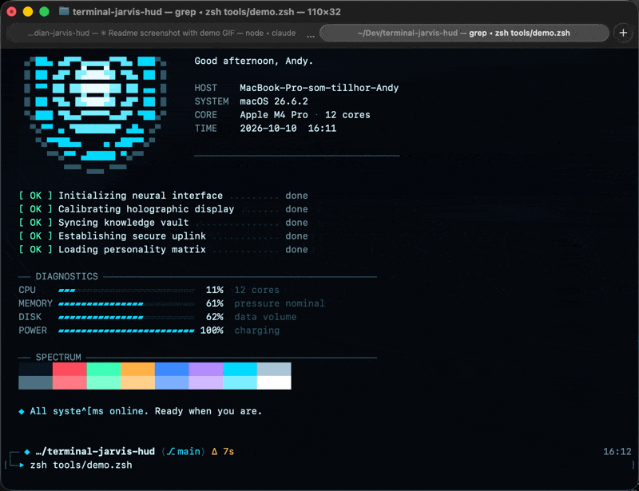

# Terminal Jarvis HUD

A sci-fi HUD look for **macOS Terminal**, inspired by the holographic interfaces in the Iron Man and Avengers films. Arc-reactor cyan on near-black, a two-line HUD prompt and a short J.A.R.V.I.S. status greeting when you open a window.

Companion to [obsidian-jarvis-hud](https://github.com/andyjohansson/obsidian-jarvis-hud).



## What's included

| Part | File | What it does |
|---|---|---|
| Color profile | `Jarvis HUD.terminal` | Background, text, cursor, selection and all 16 ANSI colors for Terminal.app |
| Prompt | `starship/starship.toml` | Two-line HUD prompt for [Starship](https://starship.rs): folder, git branch and status, command duration, clock |
| Start banner | `banner/jarvis-banner.zsh` | Greeting by time of day plus time, macOS version, uptime and battery |
| Installer | `install.sh` | Sets it all up, safe to run again |

The prompt only uses standard Unicode symbols, so it works with the default SF Mono font. No Nerd Font needed.

```
┌─ ◆ ~/Dev/terminal-jarvis-hud ⟨⎇ main⟩ ●            10:42
└─▸
```

## Install

```bash
git clone https://github.com/andyjohansson/terminal-jarvis-hud.git ~/Dev/terminal-jarvis-hud
cd ~/Dev/terminal-jarvis-hud
./install.sh
```

The installer:

1. Imports the **Jarvis HUD** profile into Terminal and makes it the default
2. Copies the prompt to `~/.config/starship.toml` (backs up an existing one)
3. Copies the banner to `~/.config/jarvis/`
4. Adds a clearly marked block to `~/.zshrc` (replaced, never duplicated, on re-runs)

It needs Starship. If you don't have it:

```bash
brew install starship
# or without Homebrew:
curl -sS https://starship.rs/install.sh | sh -s -- -b ~/.local/bin
```

## Demo

```bash
zsh tools/demo.zsh          # animated boot sequence, about 6 seconds
zsh tools/demo.zsh --fast   # straight to the final frame
```

Arc reactor ignition, boot checks, live CPU, memory, disk and battery readouts, and the color spectrum.

## Settings

Set these in `~/.zshrc`, inside or above the `jarvis-hud` block:

| Variable | Values | Default |
|---|---|---|
| `JARVIS_NAME` | Name in the greeting | First name from your macOS account |
| `JARVIS_LANG` | `en` or `sv` | `en` |
| `JARVIS_BANNER` | `0` turns the banner off | on |

## Palette

| Role | Color |
|---|---|
| Background | `#05090F` (96% opacity, light blur) |
| Text | `#D4F3FF` |
| Accent / cursor | `#00D8FF` |
| Gold (warnings, git changes) | `#FFB347` |
| Red (errors) | `#FF4D5E` |

To change colors, edit `PALETTE` in `tools/build_profile.py` and run `python3 tools/build_profile.py` to rebuild the profile.

## Uninstall

1. Delete the `jarvis-hud` block from `~/.zshrc`
2. Remove `~/.config/jarvis/` and restore your `starship.toml` backup if you had one
3. In Terminal → Settings → Profiles, pick another default and delete **Jarvis HUD**

## Credits

Not affiliated with Marvel or Disney, the name is a nod to the films.

## License

[MIT](LICENSE)
